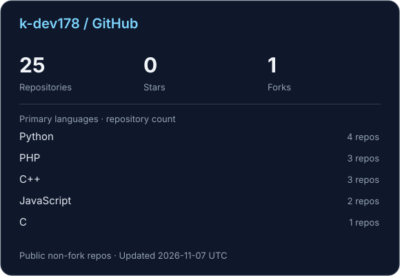

# 안녕하세요, k-dev178입니다 👋

**백엔드 개발자를 목표로 공부하는 컴퓨터공학도**

필요한 도구를 직접 만들고, 배운 내용을 코드와 기록으로 남기고 있어요.

[프로젝트](#-projects) · [학습 기록](#-learning) · [이메일](mailto:gwisej68@gmail.com)

## 👋 About

- 컴퓨터공학과 2022학번이에요.
- 학생 학점 데이터를 활용하는 졸업작품을 진행하고 있어요.
- Java / Spring Boot와 Python / FastAPI를 공부하며 백엔드 개발을 준비하고 있어요.
- 자료구조와 알고리즘 등 CS 기초도 꾸준히 다지고 있어요.

## 🛠 Tech Stack

| 구분 | 기술 |
| :--- | :--- |
| 사용 경험 | Python · C · Flask |
| 공부 중 | Java · Spring Boot · FastAPI |
| 도구 · 환경 | Git · GitHub · Linux (CentOS) |

## ⚡ Projects

실제로 필요해서, AI와 함께 만들어본 도구들이에요.

| 프로젝트 | 소개 |
| :--- | :--- |
| [Job_Scrape](https://github.com/k-dev178/Job_Scrape) | 원티드 개발자 채용 공고를 바탕으로 기술 스택별 수요를 살펴보는 도구 |
| [dc_voicereply-downloader](https://github.com/k-dev178/dc_voicereply-downloader) | 디시인사이드 보이스리플 다운로드 도구 |
| [cde_auto](https://github.com/k-dev178/cde_auto) | Python으로 만든 자동화 프로젝트 |

## 📚 Learning

- [codeup_100](https://github.com/k-dev178/codeup_100) — 코드업 기초 문제 풀이
- [git-study-summary](https://github.com/k-dev178/git-study-summary) — Git 학습 정리
- [MyStudySummary](https://github.com/k-dev178/MyStudySummary) — 공부한 내용 모아보기

## 📊 GitHub

공개 원본 저장소 기준 · 대표 언어는 저장소 수로 집계 · 매일 자동 갱신

## 📫 Contact

[gwisej68@gmail.com](mailto:gwisej68@gmail.com)
